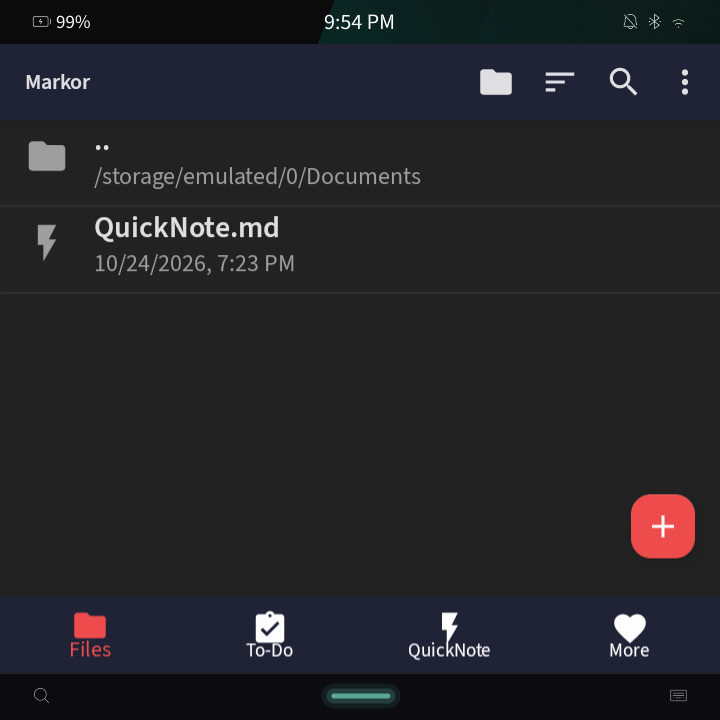
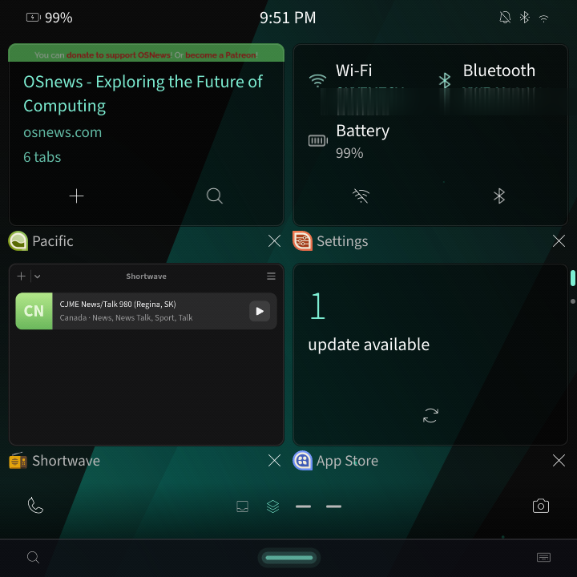
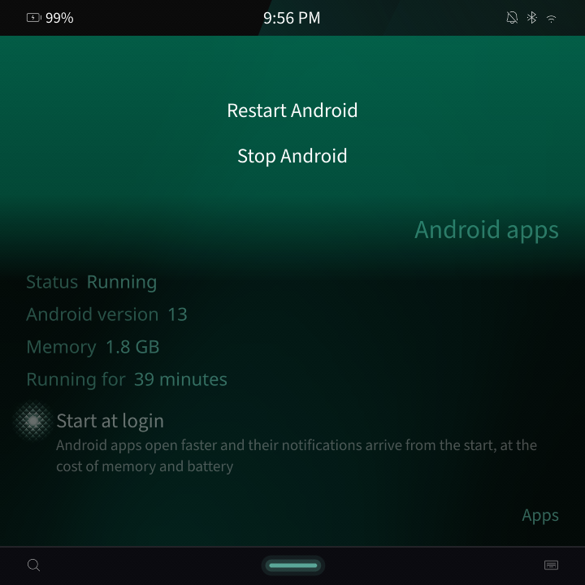

# Deckard

Deckard runs Android apps on [Marathon OS](https://github.com/patrickjquinn/Marathon-Shell)
as Marathon apps. Each Android task is its own window and switcher card, with
no Android chrome. Notifications go to Marathon's Hub with inline reply, media
sessions become MPRIS players, and permission prompts are drawn by the shell.
Back, the keyboard and the colours are Marathon's.

| | | |
|:---:|:---:|:---:|
|  |  |  |

Deckard started as a set of Marathon additions to Waydroid. It now replaces
Waydroid's host side with Rust: no Python and no C++ run on the host. Android
itself is LineageOS 20 (Android 13) from Waydroid's images, with Marathon's
system apps and a slimmed system mounted over it. A LineageOS 23.2 image
built by Deckard is in progress.

## Parts

| Component | Runs as | Does |
|---|---|---|
| `deckard-containerd` | `deckard-container.service` (root) | Creates and runs the LXC container `deckard`, its network (`deckard0`) and binder devices, and serves `id.waydro.Container` |
| `deckard-runtime` | `deckard-session.service` (user) | Starts Android for the session, sets display and locale properties, and launches apps |
| `deckard-bridge` | `deckard-bridge.service` (user) | Joins Android to the shell over three sockets: windows, notifications, media, permissions, packages, sharing, location, toasts and the keyboard. Serves `org.marathonos.Deckard` |
| `deckard-launch` | `/usr/libexec/deckard-launch` | What an Android app's desktop entry runs: starts Android if needed, then opens the app |
| `deckard-migrate` | `deckard-migrate.service` (root, at boot) | Moves a Waydroid install's data and names to Deckard's, journaled and reversible |
| `image/` | inside Android | DeckardBridge, DeckardSystem, DeckardIme, the blank home, the patched PermissionController, microG and the system overlay |

The wire protocol between the bridge and Android is in
[protocol/bridge.md](protocol/bridge.md).

## Measurements

From the HackberryPi CM5 (Raspberry Pi CM5, 16 GB), against the C++ bridge
and Python Waydroid 1.6.3 that Deckard replaced. Details and method are in
[docs/benchmarks.md](docs/benchmarks.md).

| | Deckard | Replaced |
|---|---:|---:|
| Bridge memory (PSS) | 7.1 MB | 13.9 MB |
| Container manager memory (PSS) | 2.7 MB | 23.3 MB |
| Session memory (PSS) | 2.5 MB | 23.1 MB |
| Idle wakeups, all three daemons | 0/s | 0/s |
| Keystroke to Android and back (median) | 11.0 ms | 13.7 ms |
| Notification to the Hub (median) | 3.05 ms | 3.48 ms |

Android boots in about 12 s from a cold start. microG adds about 120 MB of
Android memory and gives apps Google push without a Google account
([docs/microg.md](docs/microg.md)).

## Requirements

Deckard depends on Marathon Shell: the bridge talks to the shell's D-Bus
services (`org.marathonos.Shell`), and the shell treats `deckard.<package>`
windows as apps. It does not run under another desktop.

The kernel needs binderfs, cgroup v2 and the usual LXC options. The container
uses Waydroid's Wayland hwcomposer, so the GPU needs a Mesa driver with
linux-dmabuf support.

## Android images

Android's `system.img` and `vendor.img` (about 1.4 GB for LineageOS 23.2)
reach a phone in the `deckard-images` package, under
`/usr/share/deckard/images`. A phone keeps exactly one image set: an update
replaces the previous images (the new ones written and verified, then the old
ones deleted), Init removes any instance copy once the packaged set is in use,
and nothing keeps side-by-side copies or backups. Rolling back means
installing the previous release.

## Building

The host side is a Cargo workspace:

```sh
cargo build --workspace --release --locked
cargo clippy --workspace --all-targets --locked -- -D warnings
dbus-run-session -- env DECKARD_BRIDGE_PRIVATE_BUS=1 DECKARD_RUNTIME_PRIVATE_BUS=1 \
    DECKARD_IME_PRIVATE_BUS=1 cargo test --workspace --locked
```

For a phone (aarch64, musl):

```sh
CARGO_TARGET_AARCH64_UNKNOWN_LINUX_MUSL_LINKER=musl-gcc \
RUSTFLAGS='-C target-feature=-crt-static' \
cargo build --release --target aarch64-unknown-linux-musl --locked
```

Marathon packages Deckard as the `deckard` aport in Marathon-Shell
(`packaging/packages/deckard`), with Android's images in `deckard-images`.
To build the package from a checkout, run this in Marathon-Shell:

```sh
DECKARD_SRC=/path/to/Marathon-Deckard scripts/qemu/lib/build-deckard-apk.sh
```

The Android apps under `image/apps` are built with `image/tools/build-apk.sh`
(no Gradle) and committed, because the Alpine package build has no Android
SDK. `deckard-image-tools` generates the theme palette, the fonts and the
PermissionController patch.

## Documentation

- [docs/design.md](docs/design.md): how Android tasks become Marathon windows
- [docs/bridge.md](docs/bridge.md): the bridge and its channels
- [docs/keyboard.md](docs/keyboard.md), [docs/permissions.md](docs/permissions.md), [docs/settings.md](docs/settings.md)
- [docs/slim.md](docs/slim.md): what is removed from the Android system
- [docs/benchmarks.md](docs/benchmarks.md): measurements against Waydroid
- [docs/pilot.md](docs/pilot.md): Android apps as Keel Actions for the Pilot assistant

## Licence

GPL-3.0-or-later, except `image/deckard-image-tools` (GPL-3.0-only). See
[LICENSE](LICENSE). The Android images, microG and the PermissionController
APK keep their own licences.
