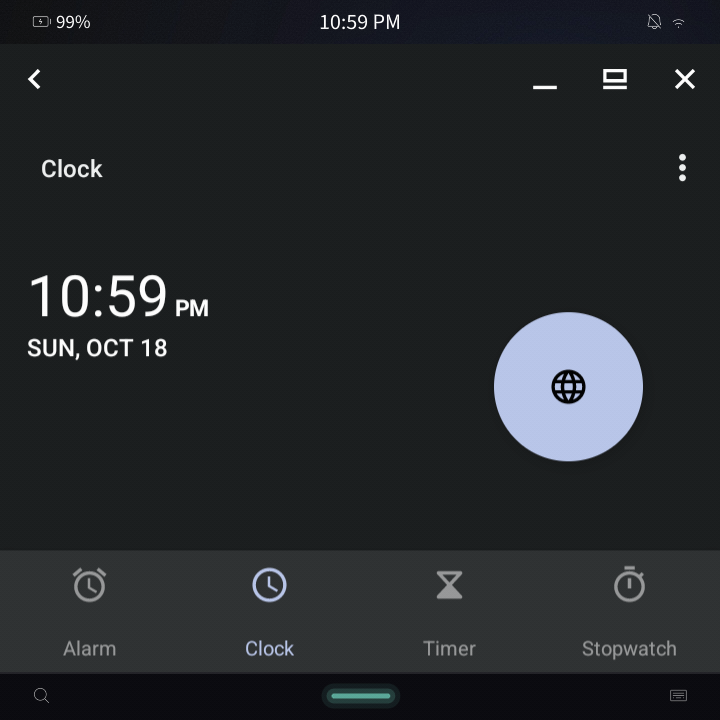
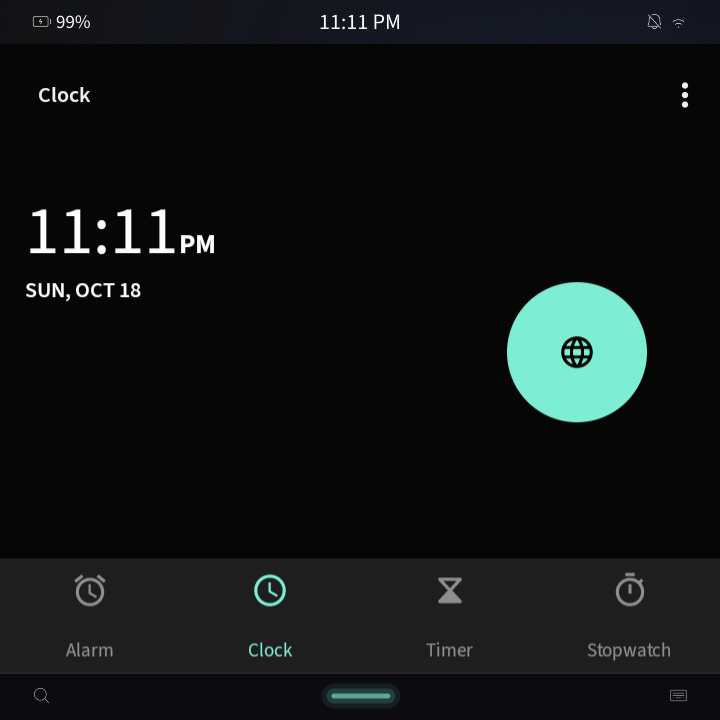
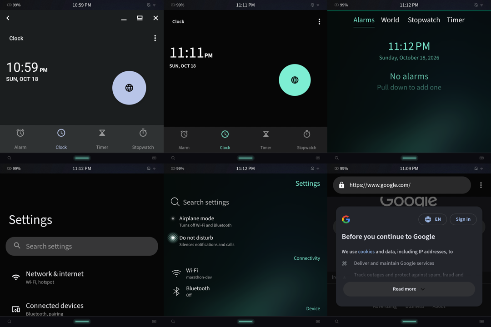
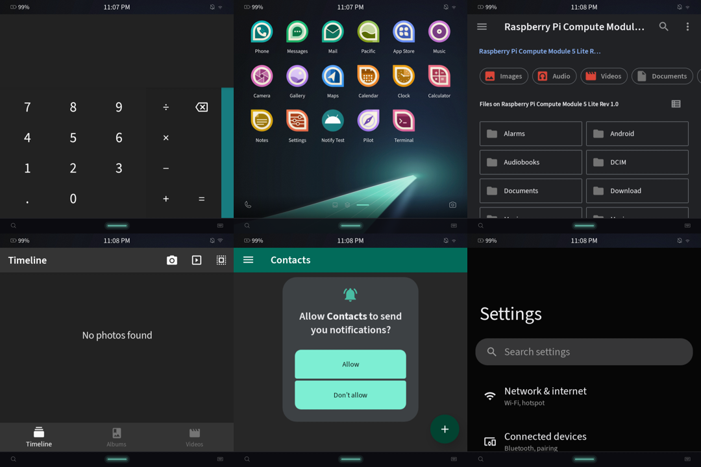

# Android chrome and theme

Goal (design §5, §12, M1 exit criteria): nobody can spot Android chrome, and
Material 3 apps show Marathon's colours. Measured on the HackberryPi CM5
(Waydroid 1.6.3, LineageOS 20 VANILLA 20260927, userdebug) on 18 October
2026, without rebuilding the Android image. Everything here is an overlay
APK, an init script, a small framework-side daemon or a setting, shipped
through Waydroid's overlay directory (`image/overlay`, packaged by the
`deckard` aport).

## Result

Measured after a session restart with these changes (23:00–23:12 IST):

| | |
|---|---|
|  |  |
| Clock before: Waydroid's caption, Monet's blue FAB, Roboto, grey surfaces | Clock after: no caption, fills the window, `#040404` floor, teal FAB `#7cedd2` (`#7df0d4` through the shell's 6-bit panel dither), Source Sans 3 |



Top: Clock before, Clock after, Marathon's Clock. Bottom: Android Settings
after, Marathon's Settings, Jelly after (web content also renders in
Source Sans 3 and dark).



First pass (before the tertiary fix): Calculator, Jelly (that launch went to
Home: a shell issue; the retry is in the sheet above), Files, Gallery,
Contacts (with Android's notification-permission prompt), Settings.

- Window fit: Settings, Contacts, Gallery, Files, Jelly and Clock all
  `mode=freeform bounds=[0,0][720,628]` (the display, which is Marathon's
  viewport) and all `visible=true` at once.
- No caption, status bar or navigation bar in any window; Launcher3
  disabled, DeckardHome resolved as home and never mapped.
- Measured colours: Settings background `#040404` and search field
  `#353536` (`elev5`), exact; Clock's bottom bar `#1c1c1d` (`elev3`),
  exact; filled buttons `#7becd1`/`#7cedd2` (highlight within dither);
  Contacts' toolbar `#016a59` (`accent1_600`).
- Density: `wm density` 254. Marathon's list titles have a 17 px cap height
  (Source Sans 3 at 25 px: `fontSizeMedium`); Android Settings' homepage
  titles 21 px (20 sp = 31.75 px at 254, the size Settings uses there).
- Not themed, as expected: Gallery (gallery3d keeps its own Holo-era
  palette), DocumentsUI's link colour (`#8cb5f8`, its own resource),
  Google's web page.

## Before

- Each Android app was a freeform window: 371×408 px centred in a 720×628
  black Marathon window (`wd/shots/08-clock-fg.png`), with Android's freeform
  caption (`< _ ▭ ✕`) across its top.
- Full-UI mode showed Android's status bar, navigation bar and launcher
  (`switcher-empty2.png`).
- Colours were Monet's wallpaper-derived default (pale blue FAB in Clock).

## How Waydroid decides what reaches Marathon

From `android_hardware_waydroid` (lineage-20, `hwcomposer/modes/multi-window.cpp`)
and `android_vendor_waydroid` (`base-patches-33/frameworks/base`):

- In multi-window mode the hwcomposer makes one Wayland toplevel per task
  and puts only layers named `TID:<task>#...` into it (patch 0007 names
  every window that belongs to a task), plus the IME window. Android's
  status bar, navigation bar, wallpaper, toasts and other system windows
  belong to no task, so **they never reach Marathon** in multi-window mode.
  They do in full-UI mode, which Marathon never uses (`Waydroid.desktop` is
  hidden).
- Launcher3 and Settings' FallbackHome are hard-coded in the hwcomposer's
  blacklist; `waydroid.blacklist_apps` (colon-separated, read when the
  composer starts) adds more.
- Every toplevel is the size of Android's single display, which follows the
  last `xdg_toplevel.configure` (×scale). Layers are placed at their display
  coordinates. So a task fills its Marathon window exactly when the task's
  bounds equal the display.
- Android puts apps in freeform mode because Waydroid's `pc.xml` declares
  `android.hardware.type.pc`, which makes the display's default windowing
  mode freeform. Default freeform bounds come from
  `LaunchParamsUtil.getDefaultFreeformSize` (a phone-shaped box, then inset
  27 dp from the display edges), hence the 371×408 window.
- The caption is `DecorCaptionView`, which `DecorView` adds to any standard
  activity in freeform mode (`WindowConfiguration.hasWindowDecorCaption`).
  Waydroid's patches 0018–0022 add back, minimise and PiP buttons to it.
  `persist.wm.debug.caption_on_shell` would move it into WMShell, whose
  decoration Waydroid also names `TID:` (so it would still show).
- `policy_control=immersive.full=*` (Waydroid re-implements PolicyControl in
  patch 0029; `waydroid app launch` sets it) hides the status and navigation
  bars from insets, but only while that setting holds.

## What Deckard changes

| Piece | Where | Mechanism |
|---|---|---|
| No caption | `DeckardFrameworkRes` (static RRO on `android`) | Overlays `layout/decor_caption` with the same view tree (ids `caption`, `back_window`, `pip_window`, `minimize_window`, `maximize_window`, `close_window`, which `DecorCaptionView` and Waydroid's patches look up) and a 0 dp caption. `DecorCaptionView.onMeasure` then gives the app the whole window, and `getCaptionInsetsHeight()` is 0. |
| No bars, no double insets | `DeckardFrameworkRes` | `config_showNavigationBar=false`; `status_bar_height_*`, `navigation_bar_*` dimens 0 dp. Holds even if `policy_control` is reset. The init script also sets `policy_control=immersive.full=*` at boot. |
| Window fit | `deckard-wm` (`/system/framework/deckard-wm.jar`, an `app_process` service run by init as `system`) | A `TaskStackListener` and a display listener; on any task or display change it makes every standard task on display 0 a freeform task with bounds equal to the display, through `IWindowOrganizerController.applyTransaction` (`WindowContainerTransaction.setWindowingMode` + `setBounds`). Fullscreen tasks are converted too: a fullscreen task makes every task below it invisible, and Waydroid then destroys their windows (their Marathon cards go). Full-display freeform tasks don't hide each other (measured: Jelly, Gallery and Calculator all `visible=true`). `LaunchParamsPersister` remembers the bounds, so the next launch of an activity starts full-size. The daemon exits when system_server dies and init restarts it. |
| Letterboxing | `DeckardFrameworkRes` | Only fixed-orientation apps on a viewport of the other orientation (the HackberryPi's 720×628 is landscape) letterbox, inside their window: background `#040404`, square corners, no reachability education or double-tap repositioning. |
| Home, launcher | `DeckardHome` (`org.marathonos.deckard.home`, `/system/product/app`) | A translucent HOME activity that draws nothing, preferred with `cmd package set-home-activity`; Launcher3 is disabled (`pm disable`). Launcher3 is in the hwcomposer's built-in blacklist and DeckardHome in `waydroid.blacklist_apps` (set by the init script `on init`). Saves Launcher3's process (and its QuickstepLauncher recents service). |
| Palette | `DeckardPalette` (static RRO on `android`, priority 901) + `DeckardSystemUIRes` (`bool/flag_monet=false`) | See below. |
| Dark mode | `DeckardFrameworkRes` `config_defaultNightMode=2`; init: `cmd uimode night yes` | Marathon has no light theme (`MColors`: "there is no light theme"). |
| Font | `vendor_deckard/fonts/fonts.xml` + host `deckard-fonts-sync` | See below. |
| Density | device `waydroid.cfg` `[properties]` `ro.sf.lcd_density=254` | See below. |
| Stock pickers | init script | `pm disable` wallpaper pickers (`com.android.wallpaper`, `.livepicker`, `org.lineageos.backgrounds`), dreams, Easter egg, print spooler and print services; `screensaver_enabled=0`. |

## Palette (§12)

- **Monet off.** LineageOS 20's `ThemeOverlayController` reads
  `Flags.MONET`, a `ResourceBooleanFlag` on SystemUI's `bool/flag_monet`.
  `DeckardSystemUIRes` sets it false, so SystemUI makes no wallpaper or seed
  palette; the init script disables the two fabricated overlays an earlier
  boot left (`com.android.systemui:accent`, `:neutral`), which are mutable
  and would otherwise sit above any static overlay.
- **Static RRO** over the 65 `system_accent1..3_*` / `system_neutral1..2_*`
  colours, generated by `vendor_deckard/overlay/DeckardPalette/gen-palette.py`
  from `MColors.qml` and the ambience highlight (default `#7df0d4`, which
  `ambiencederivation.cpp` gives every bundled wallpaper but four). Each
  palette is a CIE LCh tonal ramp (shade N at L* = 100 − N/10, Material's
  tone): accent1 the highlight's hue and chroma, accent2 the same hue at
  chroma 16, neutral1 MColors' grey (chroma 1.5), neutral2 teal-tinted grey
  (chroma 4). accent3 (Material's tertiary: Clock's FAB and selected tab)
  is a copy of accent1, because Marathon has one accent; a hue-shifted
  tertiary showed as light blue. The shades Android maps to Marathon
  roles in dark mode are then exact tokens:

  | Android shade | Android role (dark) | Marathon token |
  |---|---|---|
  | accent1_100 | framework `colorAccent` | ambience highlight `#7df0d4` |
  | accent1_200 | Material `primary` | `#7df0d4` |
  | accent1_800 | Material `onPrimary` | `textOnAccent` `#000000` |
  | neutral1_900 | `colorBackground`, Material `surface`/`background` | `background` `#040404` |
  | neutral1_800 | framework `surface_dark` | `elev3` `#1c1c1d` |
  | neutral1_700 | framework surface variant/header | `elev5` `#353536` |
  | neutral1_100 | Material `onSurface` | Silica `primaryColor` `#ffffff` |
  | neutral2_200 | Material `onSurfaceVariant` | Silica `secondaryColor` (white 60 %) over the floor, `#9b9b9b` |
  | neutral2_700 / 800 / 900 | Material `surfaceVariant` and below | `elev4` / `elev2` / `elev1` |

- `idmap2 create --policy product` maps all 65 colours, the 18 framework
  resources and `flag_monet` (checked on the device against the image's
  `framework-res.apk` and `SystemUI.apk`).
- The static overlay matches the default ambience. Following a changed
  ambience at run time needs a fabricated overlay rebuilt from the new
  highlight (A13's `cmd overlay fabricate` takes one resource per call, so
  this would live in `deckard-wm`, fed by a `waydroid prop set` from the
  host on `org.marathonos.Shell.Ambience1.AmbienceChanged`). Not done.
- Apps on Material Components with dynamic colour, and AOSP/LineageOS apps on
  `Theme.DeviceDefault`, pick this up. Apps with their own fixed palette
  (including Material 3 apps that don't opt into dynamic colour) don't: a
  hard limit, as the design says.

## Font

Android uses Marathon's font set: the faces the host renders with, from
the host's `/usr/share/fonts`, copied in at container start.

| Android family (and aliases) | Marathon face | Host file |
|---|---|---|
| `sans-serif` (thin, light, medium, black, arial, helvetica, tahoma, verdana, google-sans*, roboto*), `sans-serif-condensed` (light, medium), `sans-serif-smallcaps`, `casual`, `cursive`, `source-sans-pro` | Source Sans 3, Silica's UI face (it stands in for Sail Sans Pro) | `source-sans-3/SourceSans3-*.ttf`; 500 is Semibold (no Medium), 800–900 Bold |
| `monospace` (sans-serif-monospace, monaco), `serif-monospace` (courier) | JetBrains Mono, the Terminal's face | `marathon/JetBrainsMono-Medium.ttf` |
| `serif` (times, georgia, …) | Noto Serif, fontconfig's serif | `noto/NotoSerif-*.ttf` (same names as Android's, so the host copies replace them) |
| fallback | Noto Sans, Noto Sans Symbols, Symbols 2, Math | `noto/` |
| Arabic, Hebrew, Armenian, Georgian | DejaVu Sans (fontconfig's pick on the host) | `dejavu/DejaVuSans{,-Bold}.ttf` |
| emoji | Noto Color Emoji (`font-noto-emoji`, now in marathon-base-config) | `noto/NotoColorEmoji.ttf`, same name as Android's |
| CJK, Indic, Thai, other scripts | none on the host: Android keeps its Noto | — |

- `Typeface.DEFAULT`/`DEFAULT_BOLD` is the first family (`sans-serif`),
  `Typeface.SERIF` is `serif` and `Typeface.MONOSPACE` is `monospace`.
  Material Components and AppCompat ask for `sans-serif` and
  `sans-serif-medium` by name (aliases). Apps that bundle their own fonts
  keep them.
- `gen-fonts-xml.py` rewrites the image's `fonts.xml`
  (`fonts-lineage-20.xml`) and writes three lists:
  - `host-fonts.txt`: the 21 host files it needs.
  - `android-fonts.txt`: Android files it still names.
  - `hidden-fonts.txt`: 38 Android files nothing names any more, 18.6 MB:
    Roboto, the legacy CBDT emoji, Lato and Rubik (with
    `fonts_customization.xml` emptied), Naskh Arabic, Noto Hebrew and
    Armenian, Droid Sans Mono, Cutive Mono, Coming Soon, Dancing Script,
    Carrois Gothic SC, Source Sans Pro, and the symbol subsets. Files
    Android's `fonts.xml` never named (AndroidClock, RobotoStatic, Droid
    Sans) stay: code may open them by path.
- `deckard-fonts-sync` (an `ExecStartPre` of `waydroid-container.service`):
  - Copies the host fonts in.
  - Copies any host font with the same file name as an Android font over
    Android's. So adding `font-noto-cjk` switches Android's CJK to the
    host's with no other change.
  - Hides the unused Android files with overlayfs whiteouts.
  - If one of the 21 host files is missing, it leaves Android's own
    `fonts.xml` and fonts, because an empty family stops Android booting.
- Disk: no saving. `system.img` is a read-only image and the whiteouts only
  hide; the host copies add about 9 MB (19 MB with the emoji) under
  `/var/lib/waydroid/overlay`.
- More scripts for Marathon and Android: `optional/marathon-base-config-more-scripts.diff`
  (not applied) adds font-noto-cjk (88.8 MiB), -arabic (18.0), -hebrew (2.0),
  -devanagari (26.3), -bengali (17.7), -tamil (10.5) and -thai (4.8), about
  168 MiB. CJK then reaches Android by file name. Alpine's Indic, Thai,
  Arabic and Hebrew files are static weights under other names than
  Android's variable `-VF` files, so `gen-fonts-xml.py` would need a
  per-script mapping for them; fontconfig would then pick Noto Sans Arabic
  and Hebrew over DejaVu on the host too.

## Density

Silica sizes text in pixels × the theme pixel ratio; `fontSizeMedium` is
32 px at ratio 1.0 and the HackberryPi's ambience reports 0.79375, so body
text is 25.4 px. Android's body text is 16 sp = 16 × density / 160 px, which
is 25.4 px at density 254, the device's `FORCE_DPI`. Waydroid's default was
180 × scale = 270 (6 % larger than Marathon). Waydroid takes the density
from the host's `getprop` or `GRID_UNIT_PX` × 20 (neither fits: no
`getprop` on Marathon, and 254 isn't a multiple of 20), otherwise from
`ro.sf.lcd_density` in its base properties, so the device package's
`waydroid.cfg` seed sets `ro.sf.lcd_density = 254`. Like the other
`[properties]` it reaches Android at `waydroid init` or `waydroid upgrade -o`.

## Icons

Waydroid writes each launcher app's icon as a PNG
(`~/.local/share/waydroid/data/icons/<package>.png`) when Android's user
unlocks: the adaptive icon rendered at 72 dp × density, 121×121 RGBA at
density 270 (114×114 at 254), with Android's default circular mask. The grid
draws icons at about 68 px on this panel, so they are downscaled and sharp.
The circle is Marathon's "no square corners" shape (Media family), but there
is no Shipwright frame or cream gap. Waydroid's stock apps (Clock,
Calculator, Contacts, Files, Gallery, Camera, Music, Calendar, Browser,
Recorder, Settings) are `NoDisplay=true` in their desktop files, so only
installed apps reach the grid; Jelly's four-point star resembles the banned
AI-sparkle glyph, another reason to keep the stock browser out of the grid.

## Glass (19 Oct)

**The alpha path works.** Waydroid creates every multi-window toplevel
with a transparent background (`multi-window.cpp`, `color_transparent`), and
app windows are `fmt=TRANSLUCENT`: hardware-accelerated windows always get
an alpha format (`WindowStateAnimator`), and freeform windows also count as
translucent for their shadows. With the window background set to 50 % red,
the shell's wallpaper glow showed through the red, so alpha reaches
Marathon's compositor (`chrome-and-theme/glass-alpha-proof.png`). With it
clear (`glass-devicedefault.png`), the window looks like a Marathon app's
page.

**Platform-themed apps get glass.** `DeckardFrameworkRes` makes
`background_device_default_dark` clear. That colour is
`Theme.DeviceDefault`'s `colorBackground` and `windowBackground`, and also
the DeviceDefault dialogs' `colorBackground`. So dialogs now draw
`dialog_background_material` (overlaid) from `colorBackgroundFloating`.
That is `primary_device_default_dark`, set to bb10Card `#1a1b1c`, which also
covers popups and the legacy action bar. Measured: dialog fill `#1a1b1c`,
the page under it glass.

**AppCompat/Material Components apps set their own backgrounds** (DeskClock,
Jelly, DocumentsUI, Contacts: `m3_sys_color_dynamic_dark_background` →
`m3_ref_palette_dynamic_neutral10` → `system_neutral1_900`), and so does
SettingsLib (Settings). An experiment made `system_neutral1_900` clear
(`glass-mdc-experiment.png`):
- Clock and Settings got glass.
- Jelly's popup menu turned see-through, its items over the page text:
  Material Components' `colorSurface` is the same colour. Unusable.

So `system_neutral1_900` stays `#040404`. Glass reaches DeviceDefault apps
only, and MDC/AppCompat/SettingsLib apps keep the opaque floor. Giving them
glass without breaking menus needs per-app overlays of their own
`colorBackground`/`windowBackground` (platform-signed or preinstalled, one
per app), or an MDC-level change. Not done.

**The shell change needed.** Behind a native window `NativeAppWindow.qml`
draws `KeelAmbienceBackground` only when `keelApp` is true. `keelApp` means
a `MarathonAppRegistry` entry (Marathon manifests only) or a Keel host pid.
Otherwise it draws an opaque `MColors.background`, except while the card is
drawn from textures (`drawnByTexture`), when nothing of the app's is behind
the surface and the raw home wallpaper shows (what the glass screenshots
caught). For Android windows to sit on the same dimmed ambience as Marathon
apps:

```qml
readonly property bool ambienceBackdrop: keelApp || nativeAppId.startsWith("waydroid.")
readonly property Item backdropItem: ambienceBackdrop ? ambienceItem : null
// contentContainer:
color: nativeAppWindow.ambienceBackdrop || nativeAppWindow.drawnByTexture ? "transparent" : MColors.background
// KeelAmbienceBackground:
visible: nativeAppWindow.ambienceBackdrop
```

## Dialogs (19 Oct)

- **Framework dialogs** (`AlertDialog` under DeviceDefault, used by
  platform-themed apps and system dialogs drawn in an app's window):
  - 4 dp corners (`config_dialogCornerRadius`,
    `config_bottomDialogCornerRadius`; Marathon's `MRadius.md`).
  - bb10Card `#1a1b1c` fill with a 6 % white hairline (the shell's
    `borderGlass`).
  - Text actions in the highlight colour, Source Sans 3.
  - Screenshot: `chrome-and-theme/dialog-alert.png`.
  - Material Components apps' `MaterialAlertDialog`s use their own shape and
    surface, so they keep their look.
- **Permission prompt** (`GrantPermissionsActivity`):
  - `DeckardPermissionControllerRes` targets PermissionController's
    `PermissionControllerStyles` overlayable (policies product, system,
    vendor; the overlay needs `android:targetName`). A data-installed,
    platform-signed overlay doesn't apply: PermissionController isn't
    platform-signed.
  - It pins the Material 3 layout (`config_useMaterial3PermissionGrantDialog`).
  - It overlays `PermissionGrantDialogMaterial3` (surface),
    `PermissionGrantTitleMessage` (left-aligned 20 sp title in the primary
    colour), `PermissionGrantTitleIconMaterial3` (highlight tint) and
    `PermissionGrantButtonTop/Middle/Bottom`. The buttons follow Silica's
    dialog actions: text on the surface, accept in the highlight colour,
    decline in the primary colour, a highlight ripple, no fill.
  - Before: Material You rounded card, filled teal pills, centred title
    (`apps.png`, Contacts). After: `chrome-and-theme/dialog-permission.png`,
    measured fill `#1a1b1c`.
  - Marathon's own prompt (`PermissionDialog.qml`) is a full-screen Silica
    dialog; this is the closest an overlay gets inside Android's dialog
    frame.
- **Drawing the prompt in Marathon.** The image's PermissionController APEX
  is flattened: `/system/apex/com.android.permission/` is a directory, with
  `priv-app/PermissionController@TQ3A.230901.001/PermissionController.apk`.
  A whiteout of that directory in Waydroid's overlay plus a replacement
  PermissionController (or a GrantPermissionsActivity that forwards to
  Marathon's `Permissions1` prompt) could later let Marathon draw the prompt
  itself.
- The chooser/resolver belongs to the slim agent (`config_chooserActivity`
  → Marathon share sheet).
- Not verified on screen: a DeviceDefault popup menu. By source it is opaque
  (`popup_background_material` = `colorBackgroundFloating`, now
  `#1a1b1c`). Two shell problems got in the way on 19 Oct: the probe's card
  went black, then showed "couldn't open".

## What still needs a framework, SystemUI or hwcomposer change

- **Toasts and other system windows** never reach Marathon (no task id), so
  an app's toast is silently lost. Forwarding them needs a framework hook
  (NotificationManagerService's toast path) or the bridge.
- **Container freeze during boot (shell/deckard build of 22:52).** Right
  after `lxc-start` the container was frozen (23:00:14, 5 s after start,
  until an explicit `ContainerManager.Unfreeze`), and on the next restart
  `lxc-freeze`/`lxc-unfreeze` alternated every 1–2 s from 23:10:49 while
  Android booted. Reported to the shell agent; not a chrome issue, but
  Android must not be frozen while it boots.
- **Hotplug on every configure.** `xdg_toplevel_handle_configure` calls
  `do_hotplug()` whenever width and height are > 1, size changed or not;
  `persist.waydroid.width`/`height` only replace the size, so no property or
  fixed display size stops it. Each hotplug reconnects Android's display. On
  18 Oct system_server died in `android.display` with a
  `NullPointerException` in
  `LocalDisplayAdapter$LocalDisplayDevice.updateDisplayModesLocked`
  (`SurfaceControl$DesiredDisplayModeSpecs` was null, via
  `tryConnectDisplayLocked` ← `LocalDisplayEventListener.onHotplug`) at
  20:59:21 (2 s after an app launch mapped a new toplevel), 21:00:01,
  21:08:16 and 21:13:16 (Android clock, IST). The fix is in the hwcomposer
  (hotplug only when the size changes) or in the shell (one configure per
  new toplevel, which helps but can't avoid the first).
- **Dialog-style system UI** is restyled (see *Dialogs*) but still drawn by
  Android inside the app's window; Marathon drawing it needs the
  PermissionController replacement above and the slim agent's share sheet.
- **Stock apps** stay installed (hidden from the grid) as test fixtures and
  intent handlers (DocumentsUI for SAF pickers, Jelly for links, Settings for
  per-app settings and FallbackHome); removing them is for the image build.
- **Glass for Material Components / AppCompat / SettingsLib apps** (see
  *Glass*): only per-app overlays or an MDC change can clear their window
  background without clearing their menus.
